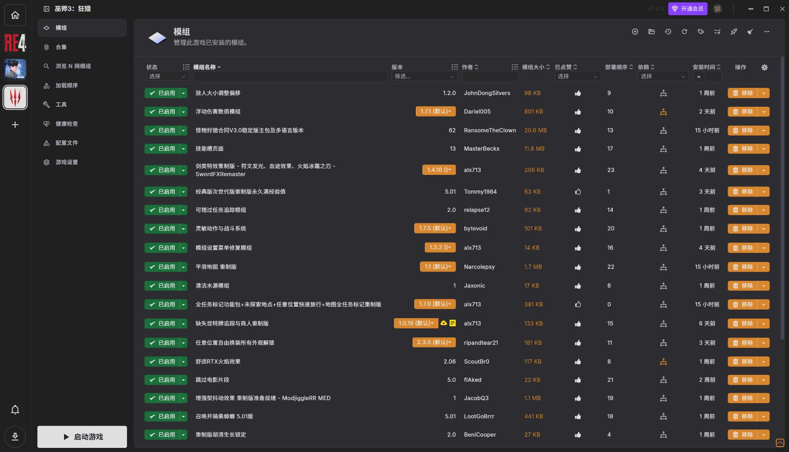

# Vortex 全界面汉化 + 模组名 AI 翻译

把 [Vortex](https://www.nexusmods.com/site/mods/1)（Nexus Mods 官方的模组管理器）变成中文的。
一个扩展搞定，不依赖任何第三方中文包。


> 界面汉化 6046 条 / 游戏固定译名 746 条 / 模组名、合集名、更新日志走 AI 翻译

---

## 先看效果

真实运行截图，没有修图、没有补字。



一张图能看全的地方：

| 位置 | 中文 |
|---|---|
| 左侧栏 | 模组 / 合集 / 搜索 Nexus Mods / 加载顺序 / 工具 / 健康检查 / 配置档 / 游戏设置 |
| 表头 | 状态 / 模组名称 / 版本 / 作者 / 模组大小 / 已点赞 / 部署顺序 / 安装时间 / 操作 |
| 状态徽章 | `已启用` |
| 操作按钮 | `移除`、`启动游戏` |
| 游戏名 | `巫师3: 狂猎` |
| 模组名 | `放入大小调整移除`、`可错过任务追踪模组`、`平滑地图 重制版`、`跳过电影片段`、`全任务标记功能包+未探索地点+任意位置快速旅行+地图全任务标记重制版` …… |

模组名这一列是模型翻的，**不是词库硬编**——所以你在自己库里随手装的、词库里根本没有的模组，也一样会变成中文。

> 图里剩下的英文不是漏翻，是下面「明确不翻」那几类：作者昵称、文件大小、版本号、模组简介原文。

---

## 为什么不是「丢个语言包进去」

市面上给 Vortex 汉化的做法基本就是塞一份 `common.json`。这个扩展分三层，各管一段：

| 层 | 管什么 | 代价 |
|---|---|---|
| **语言包接管** | 菜单、按钮、设置项、对话框 | 6046 条词库写进 i18next 最高优先级目录，**0 网络 0 token** |
| **DOM 实时翻译** | 扩展硬编码文案、第三方扩展页面标题、游戏卡片名 | 渲染时同步替换，词库命中 0 token，没命中才送模型 |
| **AI 长文本** | 模组名、合集名、更新日志、模组简介 | 任意 OpenAI 兼容接口：本地 LM Studio / Ollama，或云端 |

几个别人没有的点：

- **页面标题带 JSON 壳也能翻** —— Vortex 把扩展标题渲染成 `["LogicMods Load Order"]`，照抄原文查词库永远查不到，得先剥壳再翻、写回去不带壳
- **几千字符的更新日志能翻完** —— 按段落切片、按模型**实际加载**的上下文窗口算输出长度，超了就劈半重发，不会被服务端整批打回
- **路径保护是机制，不是提示词** —— `The Witcher 3\mods\xxx\` 这种路径发送前换成占位符，回来原样还原；模型把占位符吃掉就**整条留英文**。宁可英文，也不给你一条能把你带沟里的错路径
- **断网也能用** —— 词库命中不联网；模型层只处理词库里没有的新内容。接本地模型时全程离线
- **面板能自证没在空跑** —— 设置页实时显示「词库直接命中 N 条（不调模型）· 模型翻译 M 条 · 失败 X」，命中数一直是 0 才叫异常
- **翻过的不会重翻** —— 结果落盘到 `domCache.json`，重启、换页面、下次开机都直接命中

---

## 它能做什么

| 位置 | 效果 |
|---|---|
| **界面** | 菜单、按钮、对话框、设置项、提示语 —— 全部中文 |
| **扩展页面** | 第三方扩展注册的页面标题（含 `["LogicMods Load Order"]` 这种 JSON 壳）、硬编码文案 |
| **游戏列表** | 746 条固定中文名（Vortex 联网后支持 600+ 款，未收录的走模型兜底），命中即 0 token |
| **模组 / 合集** | 模组名、合集名、合集介绍、安装说明 |
| **更新日志** | 长文分段翻译，几千字符也能翻完 |
| **实时通知** | `8 mod updates available`、`Downloading xxx` 这类运行时拼出来的串 |

**覆盖到什么程度**：当前页面上能看到的英文基本都翻了，但**不是 100%**。

明确不翻的（翻了反而更糟）：

- 代码块、命令行、文件路径、URL、版本号、文件大小
- 纯专名：`UE4SS`、`LogicMods`、`REFramework`、`CR4Player.CanApplyOilOnItem`
- 作者昵称（只翻 `By` / `Created by` 前缀）
- 主题编辑器里的颜色变量名（`brand-primary`）、主题名（`classic` / `compact`）
- Vortex 的原生系统对话框（主进程渲染，没有多语言层）
- 日志内容

---

## 安装

三种方式，任选一种。装完都需要**重启 Vortex 两次**，并去
**设置 → 界面 → 语言** 选「中文（简体）」。

> 为什么要选语言：Vortex 的 i18n 只读「当前语言」对应的目录。
> 界面语言还是 English 时，装好的词库根本不会被加载。

### 方式一：让 AI 帮你装（最省事）

把下面这段整段复制，发给能操作电脑的 AI（WorkBuddy / Claude / Cursor 等）：

```
帮我在 Windows 上安装 Vortex 汉化扩展，按这个顺序做：
1. 下载 https://github.com/abc1317679842-ui/vortex-modname-zh/releases/latest/download/vortex-modname-zh.zip 到临时目录
2. 检查 Vortex 是否在运行，在运行就让我先关掉（文件占用会导致解压失败）
3. 把这个 zip 解压到 %APPDATA%\Vortex\plugins\vortex-modname-zh\（没有就新建，有就覆盖；不要删除这个目录里已有的 config.json）
4. 完成后告诉我：重启 Vortex 两次，然后去 设置 → 界面 → 语言 选「中文（简体）」，再重启一次
5. 最后提醒我去 设置 → 模组名汉化 填翻译接口地址和模型名
```

AI 会自己判断路径、检查进程、解压、告诉你下一步。你只需要按它说的点。

### 方式二：一键脚本

Win + X → **终端**（PowerShell）。把下面代码块里两行**一起复制、粘贴进窗口，按一次回车**即可——PowerShell 会自动先执行第一行（下载脚本）、再执行第二行（运行脚本）。一行一行分两次粘贴也行，效果一样：

```powershell
Invoke-WebRequest 'https://github.com/abc1317679842-ui/vortex-modname-zh/releases/latest/download/install.ps1' -OutFile "$env:TEMP\vortex-zh-install.ps1"
powershell -NoProfile -ExecutionPolicy Bypass -File "$env:TEMP\vortex-zh-install.ps1"
```

> 为什么不用一行 `irm ... | iex`：GitHub 的下载链接不带编码声明，Windows 自带的 PowerShell 5.1 会把 UTF-8 脚本按 Latin-1 解码，中文全是乱码。这两行是纯字节落盘，不会乱。
> 脚本做的事：检查 Vortex 是否在跑 → 下载 zip → 解压到扩展目录（保留你已填的 config.json）→ 告诉你剩下三步。不改注册表、不写扩展目录以外的位置。

脚本会：检测 Vortex 是否运行 → 下载最新版 → 解压到扩展目录 → 提示你重启。

> 不放心从网络直接执行脚本的话，用方式三。
> 也可以先把 [install.ps1](install.ps1) 下载下来看一遍再运行。

### 方式三：手动安装

1. 到 [Releases](../../releases/latest) 下载 `vortex-modname-zh.zip`（**不要解压**）
2. 打开 Vortex → 左侧 **扩展 (Extensions)** → 右下角 **从文件安装 (Install From File)** → 选那个 zip
3. 按提示**重启 Vortex 两次**（第一次写出语言包，第二次才加载它）
4. **设置 → 界面 → 语言** → 选「中文（简体）」，再重启一次
5. **设置 → 模组名汉化** → 填接口地址和模型名（见下一节）

装完如果界面还是英文：看 设置 → 模组名汉化 → 「界面汉化」那一栏，
如果显示黄字「Vortex 界面语言是 xxx」，说明第 4 步没做。

---

## 装完第一次会慢，之后就好了

这是最容易被误判成「坏了」的地方：

| 时机 | 表现 | 原因 |
|---|---|---|
| **第一次打开游戏页 / 合集页** | 看到「正在翻译 N 条」，等几十秒到几分钟 | 页面上的模组名、简介要逐条送模型 |
| **打开一段长更新日志** | 先英文，几秒后变中文 | 长文要被切成多片翻完才回填 |
| **第二次以后** | 打开就是中文，几乎无延迟 | 命中本地缓存，不再调模型 |

缓存位置：`%APPDATA%\Vortex\vortex-modname-zh\domCache.json`（页面译文）
和 `cache.json`（模组名）。同名内容只翻一次，重启不丢。

如果某段一直不翻，先看 设置 → 模组名汉化 → **「实时队列」**：

- 排队数一直不降 → 模型没在干活，点「测试连接」
- 失败数一直涨 → 接口地址 / 模型名不对
- 某条长时间挂在「正在翻译」→ 本地算力不够，把「并发路数」调成和 LM Studio 的 Parallel Requests 一样

---

## 配置翻译接口

任选一个 OpenAI 兼容的接口。**模型名必须手填**（本地可能挂多个模型，自动选第一个会选错）。

| 后端 | 接口地址 | API Key | 模型名 |
|---|---|---|---|
| **LM Studio**（本地，推荐） | `http://127.0.0.1:1234/v1` | 留空 | 必填，如 `hy-mt2-7b` |
| **Ollama**（本地） | `http://127.0.0.1:11434/v1` | 留空 | 必填，如 `qwen2.5:7b` |
| **云端**（DeepSeek / 智谱 / 硅基流动 / 混元…） | `https://api.xxx.com/v1` | `sk-...` | 必填 |

本地模型的两个经验值：

- **上下文长度**：LM Studio 里调到 8192 或更高。默认 4096 会让长日志整批失败
- **Parallel Requests**：调到 4-5，「并发路数」设成同一个数，首次翻译快好几倍

不想填也行 —— 界面照样是中文，只是模组名和更新日志不会被翻。

---

## 常见问题

**界面全英文，一条都没翻**
设置 → 界面 → 语言 选中文了吗？选完要重启。设置页「界面汉化」那栏会直接告诉你状态。

**装了两个中文包，只有一个生效**
Vortex 的 i18n 只认一份来源。装本扩展前建议先把别的中文包卸掉。
本扩展接管时会把别人的 `common.json` 备份到 `locales/zh.backup-*`，点「移除接管」能还原。

**怎么还原成英文**
设置 → 模组名汉化 → 「还原全部英文名」。语言包那栏点「移除接管（还原）」。

**翻译质量不如某个老中文包**
本项目词库基于 liuyanxi 与 Evander666 的版本（见[致谢](#致谢)），主体译文沿用了他们的成果。
机器翻译的部分（模组名、更新日志）质量取决于你用的模型：7B 本地模型够用，
云端大模型更好。

**日志在哪**
`%APPDATA%\Vortex\vortex-modname-zh\translator.log`（超过 1 MB 自动轮转为 `.log.1`）。

**能不能只装词库，不装 AI 翻译**
可以。不填接口地址就行，界面照旧是中文。

---

## 致谢

界面词库不是从零翻的，是在前人的基础上补的：

- **[liuyanxi](https://www.nexusmods.com/site/mods/29)** — *Chinese Translation for Vortex*
  2018 年起做了 6 年，是这份词库的**译文源头**（本项目 3764 条与其逐字相同，占其 90.2%）
- **[Evander666](https://www.nexusmods.com/site/mods/2320)** — *Simplified (Full Coverage)*
  2026-09 的增量补全版，补齐了紧凑视图、列显示、整合包流程、插件报错等类别
- 原项目贡献者：**xuqingxin、SettingDust、TUsama、Souma-Sumire**
- **[Vortex](https://github.com/Nexus-Mods/Vortex)** — Nexus Mods 官方，GPL-3.0

完整的条款原文、实测比对数据与本项目的许可处理，见
[LICENSE-DATA](LICENSE-DATA) 和 [THIRD-PARTY-NOTICES.md](THIRD-PARTY-NOTICES.md)。

---

## 开发

想改代码或想知道「为什么这句没翻」，看这两份：

- [docs/HOW-IT-WORKS.md](docs/HOW-IT-WORKS.md) — 三层架构、序列化回填、上下文预算、失败状态机
- [DEV-NOTES.md](DEV-NOTES.md) — 开发纪律日志，每条都对应一次真实故障（改代码前必读）

```
index.js             入口、设置页、模组名翻译
dom-translator.js    DOM 兜底层
translate-core.js    模型调用层
locale-pack.js       语言包接管
pack.json            界面词库
gamenames.json       游戏固定译名
```

---

## 许可

**代码与词库分开授权：**

| 部分 | 许可 |
|---|---|
| 源代码（4 个 `*.js`） | MIT（见 [LICENSE](LICENSE)） |
| 词库数据（`pack.json` / `gamenames.json` / `domCache.seed.json`） | **CC BY-NC-SA 4.0**（见 [LICENSE-DATA](LICENSE-DATA)） |

词库必须**署名、同协议分发、禁止商业使用** —— 这是上游作者的条款，本项目继承。
想商用请只用代码，不要带走词库。

---

<sub>This is an unofficial community translation for Vortex. Vortex and Nexus Mods are
trademarks of their respective owners. The UI dictionary is derived from
[liuyanxi's translation](https://www.nexusmods.com/site/mods/29) and
[Evander666's completion](https://www.nexusmods.com/site/mods/2320),
distributed under CC BY-NC-SA 4.0. The source code is MIT.</sub>
